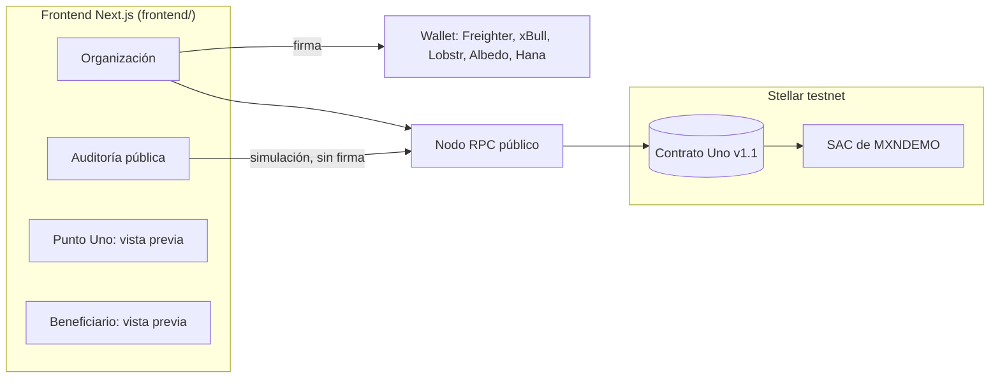

# Uno — Roadmap de ejecución del demo

> Equipo: Uriel Prado (producto, desarrollo, seguridad y pitch) + Claude (mentoría y pair programming).
> Objetivo: un demo funcional en la testnet de Stellar para el Demo Day.

---

## 1. Cómo se usa Uno (la historia del demo)

Personajes ficticios del demo:

- **María**, beneficiaria.
- **Punto Uno**, un local de verificación presencial (como los locales de World, pero sin orbe).
- **Fundación Raíces**, que reparte un apoyo escolar de $1,000 a 500 personas.
- **Un atacante**, que tiene una copia de la INE de María.

| Paso | Qué pasa (para contarlo) | Qué pasa por dentro |
|---|---|---|
| 1. Descarga | María abre la app Uno. La app le crea una "llave" que solo existe en su celular. | Se genera un par de llaves post-cuánticas en el dispositivo. La llave privada nunca sale del celular. |
| 2. Verificación única | María va a un Punto Uno con su INE. El operador confirma que es ella, en persona, y que no se había registrado antes. | El backend del verificador calcula una **huella de unicidad** a partir de la CURP y revisa en Stellar que no exista. |
| 3. Credencial | El operador aprueba y María recibe su credencial en el celular. Sus datos se borran del Punto Uno. | El verificador firma la credencial con **ML-DSA (FIPS 204)**. En Stellar solo queda: huella de unicidad + llave pública de María + quién la verificó + estado "activa". Ningún nombre, CURP ni foto. |
| 4. Programa | La Fundación crea su programa en Uno: "Apoyo escolar, $1,000, 500 lugares" y deposita los fondos. | La organización llama al contrato `create_program` y deposita el token del demo en el contrato. |
| 5. Cobro | María escanea el QR del programa y toca "Reclamar". En segundos le llegan $1,000. | La app genera un **sello** = hash(secreto de María + id del programa) y lo firma. El contrato verifica: credencial activa, firma válida y sello no usado; entonces paga. |
| 6. Doble cobro | María intenta cobrar otra vez: **rechazado**. | El sello de ese programa ya está marcado como usado. |
| 7. Suplantación | El atacante tiene la INE de María, pero no su celular: **rechazado**. | Sin la llave privada no puede generar una firma válida. |
| 8. Modo Día Q | Simulamos que una computadora cuántica rompe la criptografía clásica. Una identidad con firma clásica es suplantada; la de María, no. | La credencial clásica (Ed25519) se falsifica en la simulación; la post-cuántica rechaza la firma falsa. |
| 9. Auditoría | La Fundación ve: 500 pagos a 500 personas únicas, cero datos personales guardados. Cualquier auditor lo comprueba en el explorador de Stellar. | Lectura pública de eventos del contrato. |

**Si María pierde su celular:** regresa a un Punto Uno, se verifica otra vez, la credencial anterior se revoca y la nueva queda ligada a la misma huella de unicidad.

**La frase para explicarlo:** *"En World escaneabas tu iris para demostrar que eres humano. En Uno te verificas una sola vez en persona, tu prueba vive en tu celular y nadie se queda con tu cara. Y está protegida contra las computadoras cuánticas."*

---

## 2. Arquitectura

### Hecho

| Capa | Estado |
|---|---|
| Contrato | Uno v1.1 (`version()` = 2) en testnet: `CCPJ3LQOWC3NAJYV77FO74HKELG7YXJ4ANMSALXKHGIKAJJ6FXFQDMQQ`. Rust + `soroban-sdk` 28.0.0. 33 pruebas en `contracts/uno/src/test.rs`. La v0 (`CCLD6…YGLAG`) quedó obsoleta. |
| Funciones | Admin: `propose_admin`, `accept_admin`, `cancel_admin_proposal`, `upgrade`, `freeze_upgrades`, `add_verifier`, `remove_verifier`, `allow_token`, `disallow_token`, `unlock`. Credenciales: `issue`, `revoke`, `credential`, `is_registered`. Programas: `create_program`, `close_program`, `program`, `claim`, `claim_message`, `has_claimed`. Detalle en [docs/contrato.md](docs/contrato.md). |
| Cobro | El celular firma con Ed25519 `"UNO-CLAIM-v2" ‖ contrato ‖ program_id ‖ expires_ledger ‖ dest`. Ya no hay sello: el cobro doble lo impide `Claimed(programa, huella)` y el reclamo caduca en máximo ~1 día. La verificación de firma está aislada en una sola función para cambiarla a post-cuántica. |
| Token | MXNDEMO, activo clásico con su SAC (`CAKQX…DW2HZ`), aprobado con `allow_token`. |
| Frontend | Next.js 16 + `@stellar/stellar-sdk` 17 + Stellar Wallets Kit, con bindings generados del contrato. Organización: crear programa, depositar, seguir cobros y cerrar. Auditoría pública sin wallet. Punto Uno y Beneficiario solo como vista previa deshabilitada. |
| Datos | Sin base de datos ni datos personales: todo vive en el contrato. |

### Siguiente

| Pieza | Qué falta |
|---|---|
| Backend de Punto Uno | Ruta de servidor que reciba la CURP, calcule `HMAC(secreto, CURP)` y firme `issue` con la cuenta del verificador. El secreto nunca va en `NEXT_PUBLIC_` ni en el repo. |
| App del beneficiario | Generar y guardar la llave en el dispositivo y firmar `claim_message`. |
| Relayer | Enviar el reclamo firmado y pagar la comisión (fee bump). |
| Cuenta de recepción | Trustline a MXNDEMO para el beneficiario, idealmente con sponsored reserves. |
| Firma post-cuántica | Decidir la opción de la sección 3 y documentarla en ADR-001 (pendiente). |

### Antes de mainnet

- **A-03:** desplegar un build verificado con su hash publicado antes de `freeze_upgrades`.
- **A-04:** timelock en `upgrade` con admin multifirma, o desplegar sin upgrade.
- **M-06:** cuota o espera por verificador y monitoreo de reemisiones.
- **A-01 y M-02** siguen parciales; M-05 (vinculación entre programas) es una limitación conocida.
- Admin multifirma y solo tokens sin clawback ni comisiones (ver [docs/contrato.md](docs/contrato.md)).

---

## 3. Decisión técnica clave: verificación post-cuántica

Se resuelve en un **spike de 1 día** al inicio de la Semana 3.

| Opción | Cómo | Cuándo usarla |
|---|---|---|
| **A** | Funciones nativas de verificación post-cuántica en Soroban (Plan de Preparación Cuántica de Stellar, etapa 1) | Si ya están disponibles en testnet |
| **B** | Firmas basadas en hash (WOTS/Lamport) verificadas en el contrato con SHA-256, que Soroban ya tiene | Si A no está disponible y cabe en el presupuesto de cómputo |
| **C** | Firma híbrida: Ed25519 verificada en la cadena + ML-DSA verificada por el backend, que deja constancia en el contrato | Plan de respaldo para no frenar el demo |

**Criterio:** la opción más alta en la tabla que funcione en testnet dentro del límite de cómputo de una transacción. Se documenta en `docs/decisiones/ADR-001-firmas-pq.md`.

---

## 4. Seguridad

### Modelo de amenazas

| Amenaza | Ejemplo | Mitigación |
|---|---|---|
| Doble registro (Sybil) | Una persona saca dos credenciales | Huella de unicidad única por persona en el contrato |
| Doble cobro | Cobrar dos veces el mismo programa | Sello por programa marcado como usado |
| Suplantación | Alguien con la INE de María intenta cobrar | Se exige firma con la llave que solo vive en su celular |
| Repetición (replay) | Reenviar una firma válida para cobrar a otra cuenta | La firma cubre id del programa + sello + cuenta de pago |
| Verificador corrupto | Un Punto Uno emite credenciales falsas | Cada credencial registra quién la emitió; revocación masiva por verificador |
| Robo del celular | Usan la app de María | Desbloqueo local (PIN o biometría del sistema) + revocación |
| Ataque a la huella de unicidad | Intentar adivinar CURPs para saber quién está registrado | La huella usa un secreto del sistema (HMAC), no un hash simple de la CURP; en el MVP, el secreto vive en el backend del verificador |
| Cosecha ahora, descifra después | Guardar datos hoy y romperlos con computación cuántica | Firmas post-cuánticas y cero datos personales en la cadena |
| Fuga de secretos | Llaves en el repo | `.env` fuera de git, revisión con `gitleaks` antes de cada entrega |

### Checklist antes del Demo Day

- [ ] Ningún dato personal en la cadena, en los logs ni en el repo
- [ ] Pruebas negativas del contrato: doble registro, doble cobro, firma inválida, credencial revocada, verificador no autorizado
- [ ] Llaves del verificador y del admin fuera del repo
- [ ] Dependencias revisadas (`cargo audit`, `npm audit`)
- [ ] Limitaciones documentadas con honestidad: privacidad entre programas (requiere ZK post-cuántico) y el secreto de la huella centralizado en el MVP

---

## 5. Plan

> Fechas tentativas; ajustar al calendario oficial del bootcamp y a la fecha del Demo Day.

### Hecho

- [x] Semana 1: Problem Brief (`docs/semana1/`).
- [x] Semana 2: Product Blueprint (`docs/semana2/`) y este roadmap.
- [x] Contrato v0 en testnet (12-oct) y auditoría v0.
- [x] Contrato v1 (13-oct) y v1.1 (14-oct) con los arreglos de las auditorías; upgrade en testnet sin cambiar el Contract ID.
- [x] Pruebas negativas del contrato: doble registro, doble cobro, firma inválida, credencial revocada, verificador no autorizado y más (33 pruebas).
- [x] Semana 3 (Entregable 3): frontend con Inicio, Organización y Auditoría pública. El programa #0 se creó en testnet desde la interfaz (14-oct).
- [x] Auditorías del frontend e integral (14-oct); F-01 a F-05, R-01 y R-02 corregidos.

### Siguiente

| Semana | Tarea | Hito |
|---|---|---|
| 4 (12–18 de octubre) | Backend de Punto Uno, app del beneficiario y relayer | **Flujo completo en el navegador: registro, cobro y rechazo del doble cobro** |
| 5 (19–25 de octubre) | Modo Día Q (escena 8); pulir UI y textos; **congelar features**; video de respaldo del demo; guion del pitch y ensayos | Pitch de 3–5 minutos ensayado |

### Antes de mainnet

Fuera del Demo Day. Son los pendientes de la sección 2 (A-03, A-04, M-06, admin multifirma) y el checklist de la sección 4.

---

## 6. Fuera del alcance del MVP

- Verificación real de INE contra RENAPO o biometría real (se simula).
- Privacidad total entre programas con pruebas de conocimiento cero post-cuánticas.
- App nativa (se usa una PWA).
- Mainnet y dinero real.
