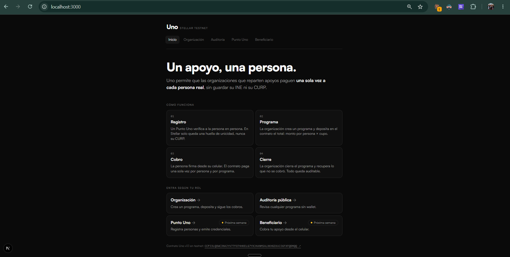
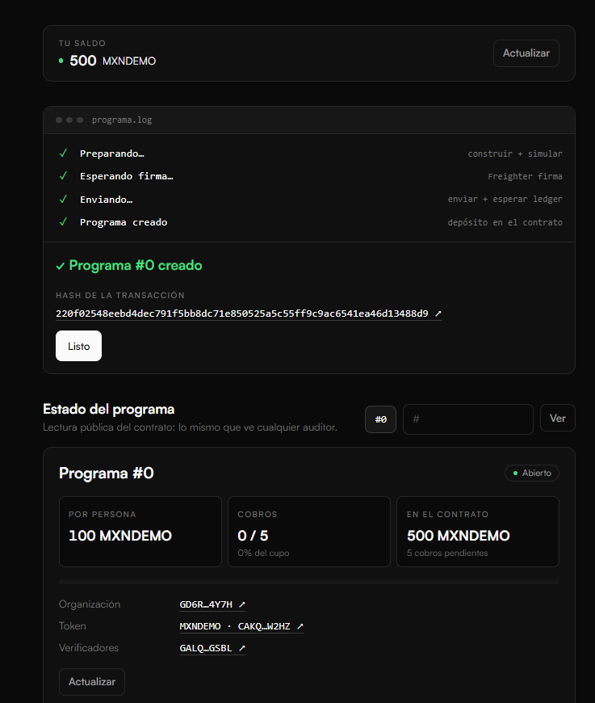
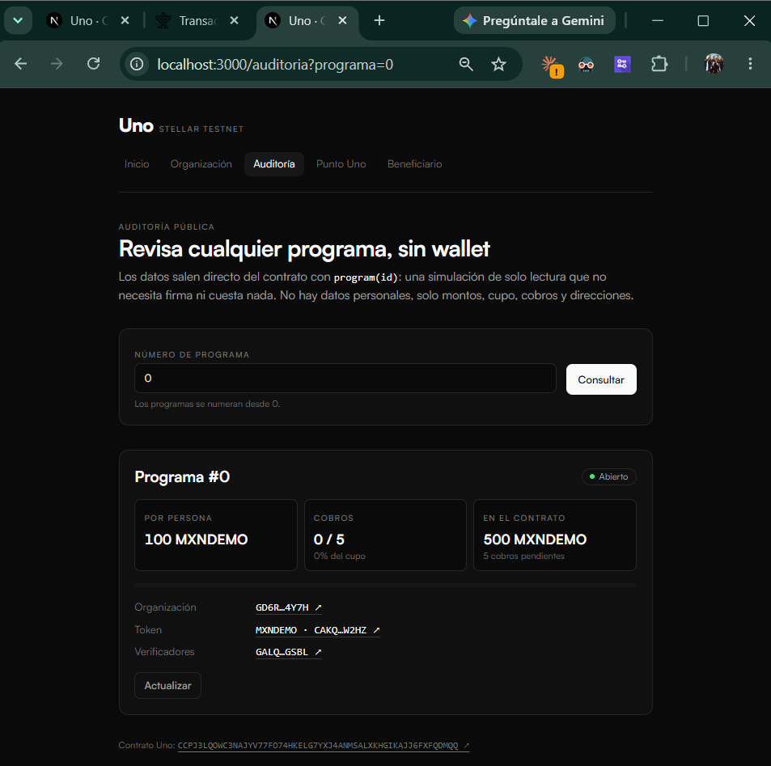
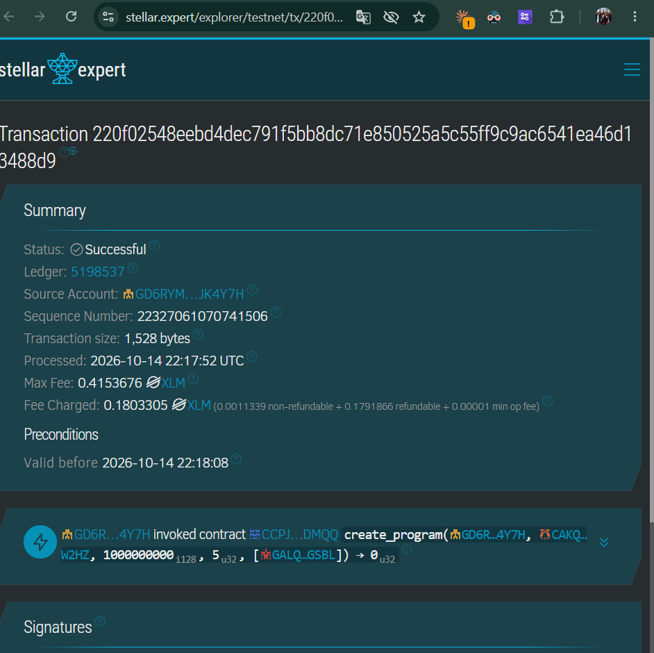
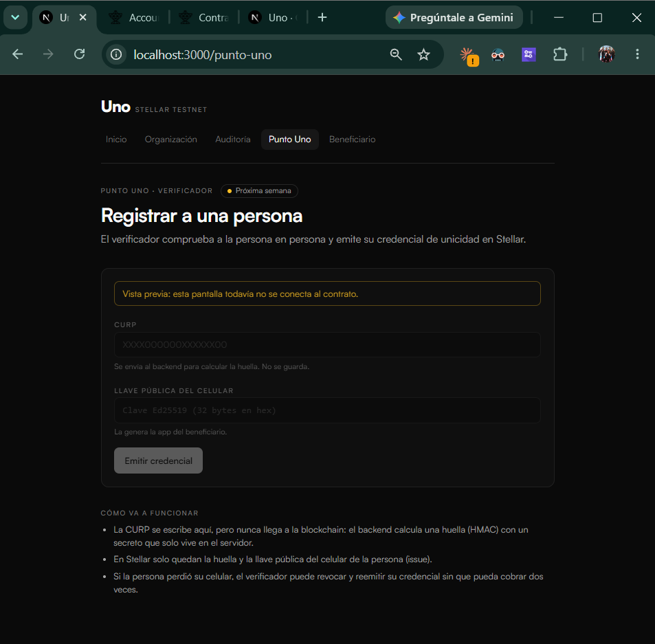
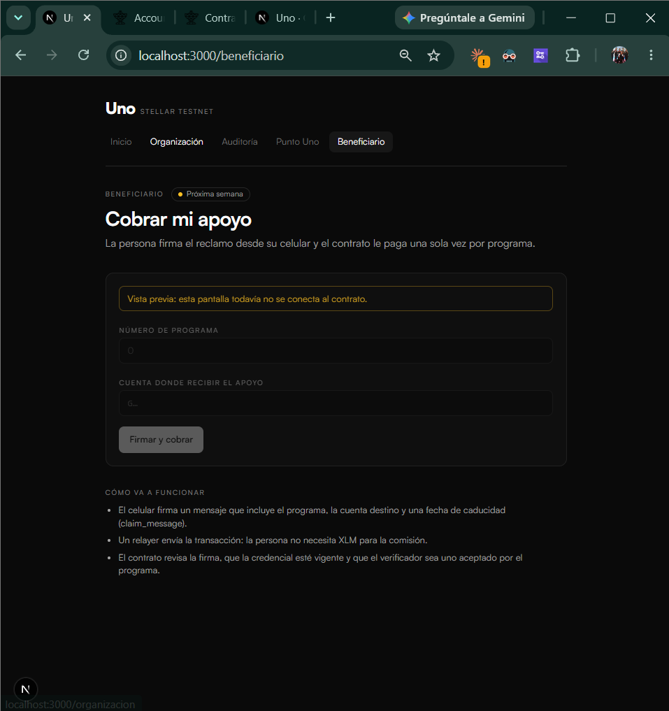

# Semana 3 — Documentación del Entregable 3

**Proyecto:** Uno, credencial de unicidad sobre Stellar.
**Repositorio:** [github.com/up-sec/uno](https://github.com/up-sec/uno)
**Contrato en testnet (v1.1):** [`CCPJ3LQOWC3NAJYV77FO74HKELG7YXJ4ANMSALXKHGIKAJJ6FXFQDMQQ`](https://stellar.expert/explorer/testnet/contract/CCPJ3LQOWC3NAJYV77FO74HKELG7YXJ4ANMSALXKHGIKAJJ6FXFQDMQQ)

---

## 1. Front construido

Esta semana construimos la primera versión web de Uno, en la carpeta [`frontend/`](../../frontend). Es una aplicación Next.js que habla directamente con el contrato Uno v1.1 desplegado en Stellar testnet. No hay servidor propio de por medio: las lecturas se hacen contra un nodo RPC público y las escrituras las firma la organización con Freighter. La app nunca ve ni guarda llaves privadas.

El objetivo de esta entrega fue cerrar, de punta a punta y con dinero de prueba real en la red, el lado de **quien paga**: abrir un programa, depositar los fondos y que cualquiera pueda auditarlo. Los roles de Punto Uno y beneficiario ya tienen interfaz, pero se conectan la próxima semana, porque dependen del backend que calcula la huella y del relayer (ver la sección 4).

### Pantallas y su conexión con el MVP

El [Product Blueprint](../semana2/ProductBlueprint.md) define siete historias de usuario y una app web con cuatro vistas: beneficiario, Punto Uno, organización y auditoría. Las pantallas siguen esa misma división.

**Inicio (`/`).** Explica en una pantalla la propuesta de valor del Blueprint, "un apoyo, una persona", y los cuatro pasos del flujo: registro, programa, cobro y cierre. Desde ahí cada rol entra a su vista. Las vistas que todavía no funcionan aparecen marcadas como "Próxima semana", para que nadie las confunda con algo terminado. Al pie se enlaza el contrato en el explorador, para que cualquier persona pueda ir a la fuente.

**Organización (`/organizacion`) — historia 1.** Atiende a la coordinadora de un programa de becas que "quiere pagar solo a personas que demostraron ser reales y únicas" (paso 5 del flujo de usuario: "crea la beca y deposita los fondos en el contrato"). La pantalla permite:

1. **Conectar la wallet** con Stellar Wallets Kit (Freighter, xBull, Lobstr, Albedo o Hana). Si la wallet está en otra red, la app lo avisa y bloquea la firma.
2. **Ver su saldo de MXNDEMO** antes de firmar. Si a la cuenta le falta la trustline al activo, lo dice en lugar de dejar que la transacción falle.
3. **Crear un programa** con el token MXNDEMO fijo, el monto por persona, el cupo y la lista de verificadores aceptados. El verificador de la CLI viene precargado. La app calcula el total a depositar (monto × cupo) y no deja firmar si el saldo no alcanza.
4. **Seguir la transacción** paso a paso: preparar (construir y simular), esperar la firma, enviar y confirmar. Si la simulación falla, por ejemplo por un token no aprobado o una cuenta sin trustline, el error aparece en lenguaje claro **antes** de pedir la firma, sin gastar comisiones.
5. **Ver el estado del programa**: monto por persona, cobros contra cupo, dinero que sigue en el contrato y verificadores en los que confía.

La lista de verificadores aceptados conecta directamente con la seguridad del contrato: un programa solo paga a personas registradas por verificadores en los que la organización confía (hallazgo A-01 de la auditoría).

**El programa #0 se creó en testnet desde esta interfaz.** La organización firmó con Freighter un programa de 100 MXNDEMO por persona con cupo de 5, y el contrato tomó los 500 MXNDEMO de su cuenta en la misma transacción: [`220f02548eebd4dec791f5bb8dc71e850525a5c55ff9c9ac6541ea46d13488d9`](https://stellar.expert/explorer/testnet/tx/220f02548eebd4dec791f5bb8dc71e850525a5c55ff9c9ac6541ea46d13488d9), ledger 5198537, 14 de octubre de 2026.

**Auditoría pública (`/auditoria`) — historia 7.** Atiende al auditor que "quiere comprobar que cada pago llegó a una persona distinta sin ver datos personales" (paso 9 del flujo). Lee `program(id)` como simulación de solo lectura: **no pide wallet, no firma y no cuesta nada**. El número del programa va en la URL (`/auditoria?programa=0`), así que el enlace se puede compartir. Solo muestra lo que el contrato guarda: montos, cupo, cobros y direcciones, sin nombres, CURP ni INE.

La misma transacción se puede comprobar en un explorador independiente. stellar.expert muestra la llamada `create_program` con la organización, el token, el monto (1000000000, es decir, 100 MXNDEMO con 7 decimales), el cupo de 5, el verificador y el resultado `0`, que es el número del programa nuevo. Es la "vista de auditoría / explorador de Stellar" que el Blueprint menciona como punto de interacción del auditor.

**Punto Uno (`/punto-uno`) — historias 2 y 3. Próxima semana.** Es el panel del operador que verifica a la persona en persona y emite su credencial (pasos 2 a 4 del flujo). La interfaz ya muestra los campos (CURP y llave pública del celular), pero está deshabilitada y explica cómo va a funcionar: la CURP solo viaja al backend, que calcula la huella HMAC. En Stellar quedan únicamente la huella y la llave pública. La historia 3, "saber en segundos si una persona ya tiene credencial", se resolverá con `is_registered(huella)`, otra lectura sin firma como la de auditoría.

**Beneficiario (`/beneficiario`) — historias 2, 4 y 5. Próxima semana.** Es la vista desde la que la persona cobra su apoyo (pasos 6 y 7 del flujo). Muestra el número de programa y la cuenta de recepción, y explica el mecanismo: el celular firma `claim_message` (programa, cuenta destino y caducidad) y un relayer envía la transacción. La historia 5, "que nadie pueda cobrar a mi nombre aunque tenga una copia de mi INE", ya está garantizada por el contrato: sin la llave del celular no hay firma válida, y hay pruebas automáticas que lo verifican.

La historia 6 (credenciales post-cuánticas) no tiene pantalla todavía. Por ahora la firma del titular es Ed25519 y está aislada en una sola función del contrato para poder cambiarla después (ADR-001, pendiente).

### Arquitectura por capas (basada en la clase 2)

Usamos como molde el `poll-dapp` de la clase 2 de Blockchain Builders 101, con las mismas versiones de dependencias (Next.js 16.4.0, React 19.3.0, `@stellar/stellar-sdk` 17.2.1 y Stellar Wallets Kit 2.7.1) y la misma separación en capas. Cada capa solo conoce a la de abajo:

| Capa | Carpeta | Responsabilidad en Uno |
|---|---|---|
| Configuración | `src/config/` | Red, RPC, Contract IDs y token, leídos de variables `NEXT_PUBLIC_` públicas. Si falta una, la app falla al compilar con un mensaje claro. |
| Cliente generado | `packages/uno/` | Bindings TypeScript generados con `stellar contract bindings typescript` desde el contrato desplegado: un método tipado por cada función. |
| Librerías | `src/lib/` | Cliente del contrato, configuración de la wallet y conversión de montos con `bigint`, para no perder centavos por redondeo. |
| Servicios | `src/services/` | Reglas de cada llamada sin nada de React: leer programas y saldos, crear programas y traducir errores técnicos a mensajes claros. |
| Hooks | `src/hooks/` | Estado para React: wallet, saldo, programa y la máquina de estados de la transacción. |
| Componentes | `src/components/` | Lo visual: pantallas, formulario, tarjeta de programa y registro de la transacción. |

Toda escritura sigue el ciclo que vimos en clase: **construir → simular → firmar → enviar → esperar confirmación**. En cada momento la transacción está en un solo estado y la interfaz muestra exactamente ese estado. Una decisión importante fue que el formulario no confíe solo en sus propias validaciones: la simulación del contrato es la última palabra, y su error se traduce a un mensaje claro (por ejemplo, "Sin trustline a MXNDEMO" o "Depósito incompleto").

En Windows ajustamos el script de bindings del molde: `rm -f` se cambió por un comando de Node, y el `^` de la versión se puso entre comillas porque `cmd` lo usa como carácter de escape. Antes de esta entrega, el frontend pasó una revisión de seguridad: no hay secretos y las vulnerabilidades altas de `npm audit` son de herramientas de desarrollo ([reporte](../auditorias/2026-10-14-frontend.md)).

---

## 2. Decisión técnica

**Elegimos la opción A: un contrato propio en Soroban.**

El problema de Uno es detectar a **la misma persona entre organizaciones distintas** que no confían entre sí, sin que ninguna guarde su identidad. Antes de escribir código revisamos lo que ya existe en el ecosistema de Stellar, y ninguna herramienta resuelve eso:

- **Stellar Disbursement Platform (SDP).** Es la herramienta natural para pagar apoyos, pero, según la documentación que revisamos, verifica a cada receptor **dentro de cada organización**. Si es así, cada organización opera su propio padrón, y una persona podría estar dada de alta en dos organizaciones y cobrar en ambas sin que ninguna lo note. No compite con Uno, lo complementa: en el futuro, una organización podría usar SDP para dispersar y consultar a Uno para saber si la persona ya cobró en otro lado.
- **Gobernanza existente (OpenZeppelin Governor, SCF).** Resuelve un problema distinto. Pondera votos por tokens o por reputación, es decir, "cuánto pesa una cuenta", no "si dos cuentas son la misma persona". No ofrece unicidad de personas.
- **HumanVouch.** Es una demo de hackathon que depende de World ID. Además de no ser un producto mantenido, hereda la verificación biométrica por iris que el Problem Brief y el Blueprint descartan: World ha sido suspendido en varios países y Uno promete verificación presencial sin biometría almacenada.

**Qué descartamos y por qué:**

- **Construir Uno solo con herramientas existentes**, sin contrato propio: ninguna ofrece un registro de unicidad compartido entre organizaciones, que es el centro del producto.
- **Una base de datos central** operada por nosotros: volvería a crear el intermediario que concentra la confianza y los datos personales, justo lo que el criterio de pertinencia del Problem Brief pide eliminar.
- **Depender de World ID u otra prueba biométrica**: contradice la propuesta de valor y la deja expuesta a decisiones regulatorias ajenas.

**Cómo se apoya en el uso de Stellar definido en el Blueprint (sección 8):**

- **Contratos Soroban:** aplican las reglas de registro, unicidad, programas y pagos con código que ningún participante controla.
- **Almacenamiento y eventos del contrato:** son el registro compartido e inalterable de huellas, cobros y revocaciones que cualquier auditor consulta. La pantalla de auditoría pública es la prueba.
- **Stellar Asset Contract:** permite fondear y pagar con MXNDEMO sin escribir un token propio.
- **Fee bump y testnet con Friendbot:** completan el diseño. El relayer pagará las comisiones del beneficiario.

Un contrato propio es lo mínimo que hace falta para que la regla "una persona, un cobro por programa" la haga cumplir la red y no nuestros servidores. Por eso mismo lo auditamos tres veces antes de construir el frontend ([auditorías](../auditorias/)).

---

## 3. Participación del equipo

| Integrante | Rol | Aportes |
|---|---|---|
| **Ángel Uriel Prado Zamora** ([up-sec](https://github.com/up-sec)) | Trabajo individual: todos los roles | **Contrato:** diseño e implementación de Uno en Soroban (v0, v1 y v1.1), 33 pruebas automáticas, despliegue y upgrade en testnet. **Auditorías:** tres rondas de auditoría del contrato y revisión de seguridad del frontend ([docs/auditorias](../auditorias/)). **Frontend:** aplicación Next.js con cinco pantallas, integración con Freighter y bindings del contrato. **Documentación:** Problem Brief, Product Blueprint, documentación técnica del contrato ([contrato.md](../contrato.md)) y este documento. |

---

## 4. Bloqueos y siguiente paso

El lado de la organización y la auditoría ya funciona en testnet. Para cerrar el flujo completo del MVP faltan cuatro piezas, todas del lado de la persona beneficiaria:

1. **Punto Uno (backend de verificación).** La huella de unicidad es `HMAC(secreto, CURP)` y **se calcula en el servidor**. El secreto es el dato más sensible del sistema: nunca puede ir en una variable `NEXT_PUBLIC_`, porque Next la incrustaría en el JavaScript que descarga cualquier navegador, ni en el repositorio. El siguiente paso es una ruta de servidor (o un servicio aparte) que reciba la CURP, calcule la huella, la borre de memoria y devuelva solo la huella para firmar `issue` con la cuenta del verificador.
2. **App del beneficiario.** La llave de la persona se genera y se queda **en su dispositivo**: nunca se envía a un servidor. Para cobrar, la app firma `claim_message(programa, caducidad, destino)` con esa llave. El contrato ya valida esa firma; falta la interfaz que genera y guarda la llave y produce la firma.
3. **Relayer.** Envía el reclamo firmado y **paga la comisión** (fee bump), para que la persona no necesite XLM. Su llave también es un secreto de servidor.
4. **Cuenta de recepción del beneficiario.** Para recibir MXNDEMO, la cuenta destino necesita una trustline al activo, y eso exige una reserva en XLM. Hay dos caminos: que la persona use una wallet que ya tenga la trustline, o crearle la cuenta con **sponsored reserves**, donde un patrocinador paga la reserva. El segundo da mejor experiencia y es el que vamos a evaluar.

**Pendiente antes de mainnet** (de la [auditoría v1.1](../auditorias/2026-10-14-v1.1.md)):

- **A-03:** `freeze_upgrades` depende de que el ejecutable vigente sea este código. Hay que desplegar un build verificado con su hash publicado.
- **A-04:** `upgrade` no tiene retraso. Hace falta un timelock con admin multifirma, o desplegar sin upgrade.
- **M-06:** un verificador comprometido puede ocupar huellas que quedaron libres y dejar a la persona real fuera de otros programas. Hace falta una cuota o espera por verificador y monitoreo de reemisiones.
